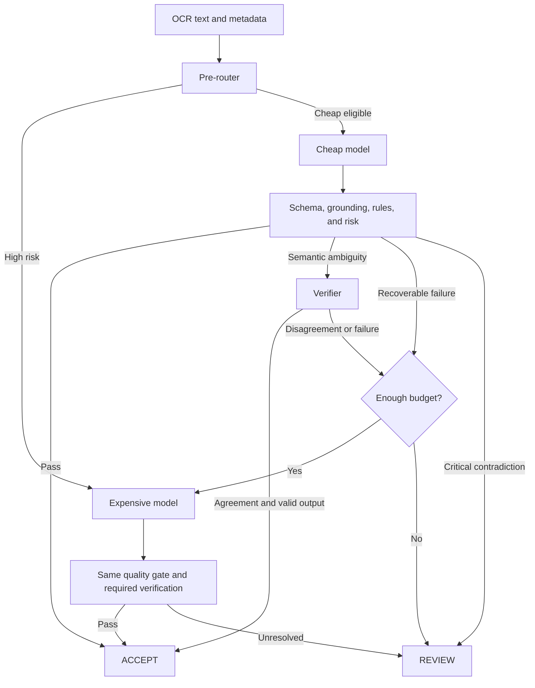

[Read the companion blog post](https://onurozkir.com/en/ai-native-swe/is-cheap-model-sufficient/)

# Assured Route

**Quality-aware routing between a cheap LLM and an expensive LLM for invoice extraction.**

This repository was built as the runnable companion to the blog post linked above.
It demonstrates how to reduce inference costs while deciding when a model output can
be accepted, when a stronger model should take over, and when automated processing
should stop for review.

The service uses FastAPI, Pydantic, asyncio, deterministic validators, and a small
heuristic risk model. It includes an offline mock mode and configurable HTTP adapters
for two OpenAI-compatible models. The architecture is intended as a practical MVP
that can be extended and evaluated with real workloads.

## Contents

- [How routing works](#how-routing-works)
- [Requirements](#requirements)
- [Quick start](#quick-start)
- [Connect two real models](#connect-two-real-models)
- [API](#api)
- [Validation and risk](#validation-and-risk)
- [Configuration](#configuration)
- [Demo scenarios](#demo-scenarios)
- [Offline evaluation](#offline-evaluation)
- [HTTP integration simulation](#http-integration-simulation)
- [Development and testing](#development-and-testing)
- [Docker](#docker)
- [Project structure](#project-structure)
- [Scope and next steps](#scope-and-next-steps)
- [Contributing, Security & License](#contributing-security--license)

## How routing works

1. A pre-router inspects the OCR text and document metadata before inference.
2. Suitable documents go to the cheap model. High-risk documents go directly to the
   expensive model.
3. Every extraction passes through schema validation, source grounding, business
   rules, and field-level risk scoring.
4. Ambiguous outputs can receive an additional verifier check.
5. Recoverable failures escalate to the expensive model if the remaining latency
   budget allows it. Critical contradictions or unresolved failures require review.



`ACCEPT`, `ESCALATE_TO_EXPENSIVE`, and `REVIEW` are internal gate decisions.
The synchronous API executes escalation within the request, so its final decision
is `ACCEPT` or `REVIEW`. A review response contains `extracted_data: null`.

The expensive model never bypasses validation. A verifier cannot override a failed
schema, critical grounding check, or business rule.

## Requirements

- Python 3.12 or newer.
- [uv](https://docs.astral.sh/uv/) for dependency management and the locked environment.
- No model credentials for mock mode.
- Two accessible OpenAI-compatible model endpoints for live mode; both may use the
  same provider and API key.
- Postman CLI 1.76.0 was used for the optional local HTTP simulation.
- Docker is optional.

## Quick start

Run these commands from the repository root:

```powershell
uv sync --locked
Copy-Item .env.example .env
uv run uvicorn assured_route.api:app --host 127.0.0.1 --port 8000
```

On Linux or macOS, use `cp .env.example .env` for the copy step. If you already have
an `.env` file, merge the desired settings into it instead of replacing it.

The default `AR_PROVIDER_MODE=mock` uses deterministic providers and requires no
network access to a model. The mock providers read labeled synthetic OCR text; they
are a routing demonstration, not a general OCR engine or an LLM accuracy benchmark.

- Interactive API documentation: [http://127.0.0.1:8000/docs](http://127.0.0.1:8000/docs)
- Health endpoint: [http://127.0.0.1:8000/healthz](http://127.0.0.1:8000/healthz)

Send the included request:

```sh
curl -sS http://127.0.0.1:8000/extract \
  -H 'Content-Type: application/json' \
  --data-binary @demo/request.json
```

PowerShell:

```powershell
$body = Get-Content -Raw -Encoding UTF8 demo/request.json
Invoke-RestMethod -Method Post -Uri http://127.0.0.1:8000/extract `
  -ContentType 'application/json; charset=utf-8' `
  -Body ([Text.Encoding]::UTF8.GetBytes($body))
```

## Connect two real models

Start with [.env.llm.example](.env.llm.example). For a new configuration, copy it to
`.env` and replace the model IDs and API keys:

```dotenv
AR_PROVIDER_MODE=openai_compatible

AR_CHEAP_MODEL=your-cheap-model-id
AR_CHEAP_API_KEY=your-cheap-api-key
AR_CHEAP_BASE_URL=https://api.openai.com/v1

AR_EXPENSIVE_MODEL=your-expensive-model-id
AR_EXPENSIVE_API_KEY=your-expensive-api-key
AR_EXPENSIVE_BASE_URL=https://api.openai.com/v1
```

Each endpoint must accept `POST /chat/completions` with Bearer authentication.
The adapter appends that path to the configured base URL. For example,
`https://gateway.example/v1` becomes
`https://gateway.example/v1/chat/completions`.

The two base URLs can point to different providers. Native Anthropic Messages,
Gemini GenerateContent, and Azure-specific authentication or query parameters need
a separate adapter or a compatible gateway.

Provider capability settings are independent for each model:

```dotenv
AR_CHEAP_RESPONSE_FORMAT=json_object
AR_EXPENSIVE_RESPONSE_FORMAT=json_object
AR_CHEAP_TOKEN_LIMIT_PARAMETER=max_completion_tokens
AR_EXPENSIVE_TOKEN_LIMIT_PARAMETER=max_completion_tokens
AR_LLM_MAX_OUTPUT_TOKENS=1024
AR_LLM_MAX_RESPONSE_BYTES=262144
```

If an endpoint does not support JSON mode, set its response format to `none`.
The prompt still requests JSON and the application still validates the response.
If a provider expects the legacy token parameter, use `max_tokens`. Unsupported
parameters produce a normal provider failure; the adapter does not retry with
alternative parameters.

Remote endpoints require HTTPS. Loopback HTTP is supported for local testing.
Redirects are not followed, and incomplete or malformed credentials and endpoint
configuration are rejected at startup. Keep real keys in `.env` or your deployment
secret store. Only the two credential-free example files belong in version control.

### Live-mode latency settings

The live example configuration includes these illustrative values:

```dotenv
AR_POLICY__CHEAP_TIMEOUT_MS=4000
AR_POLICY__PROVIDER_TIMEOUT_MS=12000
AR_POLICY__CHEAP_EXPECTED_MS=500
AR_POLICY__EXPENSIVE_EXPECTED_MS=2000
AR_POLICY__VERIFIER_EXPECTED_MS=2000
AR_POLICY__RESPONSE_RESERVE_MS=100
```

Use [demo/live-request.json](demo/live-request.json), which requests a 20,000 ms
latency budget. The endpoint default is 1,500 ms: increasing a provider timeout does
not increase the request budget. Tune expected durations, timeouts, and reserve
using measurements from your providers.

In live mode, optional verification uses the configured expensive model with a
separate verification prompt. No third model or key is needed. That verification
call is charged to the expensive-model cost estimate. Agreement from the same
model is not independent evidence of correctness.

## API

### `POST /extract`

Example request:

```json
{
  "raw_ocr_text": "document_type: invoice\ninvoice_number: INV-2026-001\ninvoice_date: 2026-10-20\ndue_date: 2026-11-20\ncurrency: TRY\ninvoice_total: 1200.00\nvat_total: 200.00\nseller_name: Acme Ltd\nseller_tax_id: 1234567890\nbuyer_name: Buyer Ltd",
  "metadata": {
    "page_count": 1,
    "ocr_quality": 0.98,
    "known_template": true,
    "high_risk": false,
    "semantic_ambiguity": false
  },
  "latency_budget_ms": 1500,
  "policy": null
}
```

The request accepts:

| Field | Meaning |
| --- | --- |
| `raw_ocr_text` | Nonblank OCR text, up to 100,000 characters. |
| `metadata` | Page count, OCR quality, known-template flag, risk flag, and semantic ambiguity signal. |
| `latency_budget_ms` | Application processing budget from 1 to 60,000 ms; default 1,500 ms. |
| `policy` | Optional overrides that can only tighten server policy. |

A policy override can require the expensive model, require verification, or lower
the accepted risk threshold:

```json
{
  "force_expensive": true,
  "require_verifier": true,
  "accept_risk_max": 0.1
}
```

Overrides cannot disable validators or raise the server's risk threshold.
Invalid requests and policy relaxation return HTTP 422. A completed routing flow
returns HTTP 200; clients must inspect `decision` to distinguish acceptance from review.

Selected fields from an accepted mock response:

```json
{
  "extracted_data": {
    "document_type": "invoice",
    "invoice_number": "INV-2026-001",
    "invoice_date": "2026-10-20",
    "due_date": "2026-11-20",
    "currency": "TRY",
    "invoice_total": "1200.00",
    "vat_total": "200.00",
    "seller_name": "Acme Ltd",
    "seller_tax_id": "1234567890",
    "buyer_name": "Buyer Ltd"
  },
  "decision": "ACCEPT",
  "selected_path": "cheap",
  "estimated_risk_score": 0.05,
  "risk_basis": "heuristic_not_probability",
  "estimated_cost": "0.0015",
  "cost_currency": "USD"
}
```

The complete [recorded response](demo/response.json) also contains field risk scores,
validation checks, a latency breakdown, and audit information. Decimal amounts and
costs are serialized as strings to preserve precision. IDs and timings change per run.

Final paths are `cheap`, `cheap+verifier`, `expensive`, and `review`. The path describes
the final outcome; `audit.calls` preserves every attempted call along the way.

### `GET /healthz`

Returns the service status and version. It is a service health check, not a check of
upstream model credentials, availability, or extraction quality.

## Validation and risk

All ten invoice fields are required:

`document_type`, `invoice_number`, `invoice_date`, `due_date`, `currency`,
`invoice_total`, `vat_total`, `seller_name`, `seller_tax_id`, and `buyer_name`.

The quality gate applies:

- **Schema validation:** invoice classification, real calendar dates in `YYYY-MM-DD`
  format, three-letter uppercase currency codes, and finite nonnegative amounts with
  at most two decimal places. Boolean values cannot stand in for amounts.
- **Source grounding:** normalized text matching and complete numeric tokens. An
  amount of `200.00` does not match the suffix of `1200.00`; date and identifier
  fragments cannot ground an amount. Fuzzy name matches require verification.
- **Business rules:** total must cover VAT, due date must not precede invoice date,
  and seller tax ID must contain 10 or 11 ASCII digits.
- **Field risk:** the highest relevant failure weight contributes to document risk,
  so a single critical failure is not averaged away.
- **Optional verification:** semantic ambiguity or fuzzy names can trigger an
  additional check; agreement cannot override failed critical validators.

These checks have practical limits: a value appearing in OCR does not prove it was
assigned to the correct semantic role. Currency validation is not an ISO-4217 catalog
lookup, and tax ID length is not an official identity or checksum validation.

The risk score is a heuristic, not a calibrated probability of error. Calibration
requires independently labeled data representative of the intended workload.

### Routing conditions

| Condition | After cheap extraction | After expensive extraction |
| --- | --- | --- |
| Critical checks pass and risk is within policy | Accept | Accept |
| Missing field, wrong type, or invalid date format | Escalate if budget permits | Review |
| Missing grounding or recoverable tax ID failure | Escalate if budget permits | Review |
| Total below VAT or due date before invoice date | Review | Review |
| Empty/malformed JSON or invalid response envelope | Escalate if budget permits | Review |
| Refusal, content filtering, or truncated output | Escalate if budget permits | Review |
| HTTP 401/403/429, other 4xx/5xx, network error, or timeout | Escalate if budget permits | Review |
| Required verification fails or disagrees | Escalate if budget permits | Review |
| Insufficient remaining budget | Review | Review |

High-risk metadata, poor OCR quality, an unknown template, a large document,
multiple currency signals, or a server bypass policy can route directly to the
expensive model. There is at most one cheap extraction, one expensive extraction,
and one verifier call per candidate. There is no unbounded retry loop or silent
fallback from live providers to synthetic outputs.

## Configuration

Settings are loaded from `.env` with the `AR_` prefix. Process environment variables
take precedence. Nested policy fields use a double underscore. Restart the service
after changing configuration.

| Setting | Purpose |
| --- | --- |
| `AR_PROVIDER_MODE` | `mock` or `openai_compatible`. |
| `AR_CHEAP_MODEL`, `AR_EXPENSIVE_MODEL` | Provider model IDs. |
| `AR_CHEAP_API_KEY`, `AR_EXPENSIVE_API_KEY` | Separate Bearer credentials. |
| `AR_CHEAP_BASE_URL`, `AR_EXPENSIVE_BASE_URL` | API base URLs before `/chat/completions`. |
| `AR_POLICY__FORCE_EXPENSIVE` | Bypass cheap extraction. |
| `AR_POLICY__ENABLE_VERIFIER` | Enable the optional verifier path. |
| `AR_POLICY__REQUIRE_VERIFIER` | Require verification for otherwise acceptable candidates. |
| `AR_POLICY__ACCEPT_RISK_MAX` | Maximum accepted heuristic risk score. |
| `AR_POLICY__CHEAP_TIMEOUT_MS` | Optional cap for cheap calls. |
| `AR_POLICY__PROVIDER_TIMEOUT_MS` | General provider call cap. |
| `AR_POLICY__RESPONSE_RESERVE_MS` | Reserve for final validation and response preparation. |
| `AR_CHEAP_COST_USD`, `AR_EXPENSIVE_COST_USD` | Fixed per-call cost estimates. |
| `AR_VERIFIER_COST_USD` | Mock verifier cost; live verification uses the expensive estimate. |

See [.env.example](.env.example) and [.env.llm.example](.env.llm.example) for the
complete starting configurations, including pre-router limits and mock delays.

### Audit, deadlines, and cost accounting

JSON audit records go to stdout and include request ID, document and policy hashes,
policy snapshot, version identifiers, routing reasons, validation attempts, call
latencies, and estimated costs. Failed live calls include a stable error code and,
when available, the upstream HTTP status.

OCR text, extracted field values, API keys, raw upstream bodies, and upstream
exception messages are excluded from audit records. Accepted API responses still
contain the requested invoice data and must be handled accordingly.

The deadline uses a monotonic clock. A stage starts only if its expected duration
and response reserve fit; HTTP and asyncio timeouts bound provider execution.
The budget is not an end-to-end network deadline or an SLO guarantee.

Every started call contributes to the fixed cost estimate, including timeout,
provider failure, and cancellation. These amounts are scenario estimates rather
than token-based billing; actual provider charges can differ.

## Demo scenarios

Run the five offline API scenarios and regenerate their synthetic request/response
artifacts:

```sh
uv run python demo/run_examples.py
```

This runner explicitly selects mock mode. The included scenarios are:

| Request | Expected behavior |
| --- | --- |
| [request.json](demo/request.json) | Cheap extraction accepted. |
| [verifier-request.json](demo/verifier-request.json) | Cheap extraction accepted after verification. |
| [expensive-request.json](demo/expensive-request.json) | High risk routes directly to expensive extraction. |
| [escalation-request.json](demo/escalation-request.json) | Cheap schema failure escalates to expensive extraction. |
| [review-request.json](demo/review-request.json) | A total/VAT contradiction returns review without extracted data. |

Matching response files are included in the same directory. These deterministic
mock results demonstrate the control flow, not real model quality or speed.

## Offline evaluation

Replay the quality gate on recorded candidates:

```sh
uv run python -m assured_route.evaluation.policy_replay demo/replay.jsonl
```

Replay uses recorded candidate values, source text, and optional verifier signals.
It does not call models, fabricate unseen expensive-model results, or simulate
pre-routing changes. Each document ID must be unique; consolidate repeated-attempt
costs into the task record first.

Coverage is reported separately from critical error rate. The latter uses only
independently labeled accepted candidates and is `null` when no such labels exist.
Teacher disagreement is not ground truth. With partial labeling, observed cost per
verified success must not be treated as population-wide production unit cost.

Run the explicit cost scenario:

```sh
uv run python -m assured_route.evaluation.cost_simulator demo/cost-scenario.json
```

The included four-million-request scenario produces USD 24,000 in estimated monthly
cost. It combines cheap, expensive, verifier, shadow, and infrastructure assumptions.
Review cost and expected error loss can be added separately. The result illustrates
the article's arithmetic; it is not a measured saving or a current vendor price quote.

## HTTP integration simulation

The local Postman simulation exercises the real HTTP adapters without paid model
calls. Its contract subset is in
[postman/contracts/chat-completions.yaml](postman/contracts/chat-completions.yaml).

Start the simulation in one terminal:

```sh
postman simulation run postman/simulations/llm-routing.sim.yaml --port 4900 --output ndjson --no-history
```

Use the URL from its `listening` event in another terminal:

```sh
uv run python demo/check_llm_routing.py --simulation-url http://127.0.0.1:4900
```

The runner invokes the service through ASGI and makes real outbound HTTP requests
through the production adapters. It covers 16 scenarios, including schema/grounding
failures, authentication errors, rate limits, server errors, malformed JSON,
refusal, truncation, timeout, direct expensive routing, verification, and review.
Stop the simulation with Ctrl+C when finished.

The mock uses synthetic data and a local subset of the upstream contract. It is
not a provider-published mock, and no cloud deployment is required. These checks
establish integration behavior against the stand-ins; real provider compatibility,
account access, latency, pricing, and extraction quality need separate validation.

## Development and testing

```sh
uv sync --locked
uv run pytest
uv run ruff check .
uv run ruff format --check .
uv run mypy
uv build
```

The tests cover schema and grounding boundaries, business contradictions, routing,
verification, deadlines, cancellation, concurrent requests, audit confidentiality,
API behavior, provider responses, client cleanup, and offline evaluation.

[GitHub Actions](.github/workflows/ci.yml) defines the same test, lint, type-check,
and package-build checks for Python 3.12 and 3.13.

## Docker

```sh
docker build -t assured-route:local .
docker run --rm -p 8000:8000 --env-file .env assured-route:local
```

The runtime image uses a non-root user and installs locked runtime dependencies.
The Docker build and runtime have not been validated in the development environment
because its Docker daemon was unavailable.

## Project structure

```text
.
├── src/assured_route/
│   ├── api.py                    # FastAPI endpoints and application lifespan
│   ├── config.py                 # Environment settings and model connections
│   ├── dependencies.py           # Provider selection and dependency injection
│   ├── audit.py                  # Structured, value-free audit logging
│   ├── core/                     # Domain models, policies, decisions, and risk
│   ├── validators/               # Schema, grounding, business rules, quality gate
│   ├── routing/                  # Pre-routing, deadlines, and bounded escalation
│   ├── providers/                # Mock and OpenAI-compatible HTTP adapters
│   └── evaluation/               # Gate replay and cost simulation
├── demo/                         # Synthetic requests, responses, and runnable demos
├── tests/                        # Unit and API contract tests
├── postman/                      # Upstream contract, mocks, and local simulation
├── .github/workflows/ci.yml
├── .env.example
├── .env.llm.example
├── Dockerfile
├── pyproject.toml
└── uv.lock
```

The provider interfaces and pure validators make it possible to replace inference
adapters or risk scoring without rewriting the routing flow.

## Scope and next steps

The service accepts OCR text; it does not perform PDF ingestion or OCR. It does not
write financial records or enqueue durable human-review tasks. Authentication,
trusted tenant metadata, ingress limits, durable audit storage, and review handling
remain integration work before a public production deployment.

The next steps are:

1. Native provider adapters, strict structured-output support, and actual usage billing.
2. Independently labeled evaluation data and calibrated field-level risk models.
3. A learned pre-router using features available before inference.
4. Asynchronous shadow evaluation with stratified sampling and independent review.
5. Tracing, quality/cost/latency metrics, control cohorts, and segment-level rollback.

The goal remains the one explored in the companion article: minimize the total cost
of successfully resolved tasks while respecting quality and latency constraints.

## Contributing, Security & License

- **Contributing**: Contributions are welcome! Please review [CONTRIBUTING.md](CONTRIBUTING.md) for local development setup, code quality standards, and pull request guidelines.
- **Code of Conduct**: All participants are expected to follow the standards outlined in [CODE_OF_CONDUCT.md](CODE_OF_CONDUCT.md).
- **Security Policy**: For vulnerability reporting and security practices regarding LLM credentials and untrusted OCR payloads, see [SECURITY.md](SECURITY.md).
- **License**: Assured Route is released under the [MIT License](LICENSE).

